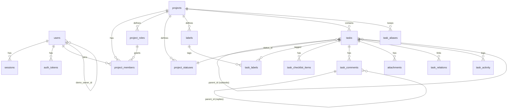

# Database

PostgreSQL 16 with the `citext` and `pg_trgm` extensions. The schema lives in plain SQL migrations under `server/src/db/migrations/NNN_name.sql`. Each milestone adds its own file.

## Migrations

- `pnpm db:migrate` applies pending files in name order, and the server also runs them on boot.
- The runner takes `pg_advisory_lock(727001)`, applies each file in its own transaction, and records it in `schema_migrations`.
- Applied migrations are never edited. A change always goes in a new file.

## Entity overview

Every table is documented column by column below as its migration lands.

## Invariants

- **Project keys** are globally unique (case-insensitive), match `^[A-Z][A-Z0-9]{1,5}$`, and never change after creation.
- **Task numbers** are unique per project and allocated with `UPDATE projects SET task_seq = task_seq + 1 … RETURNING task_seq` inside the insert transaction. The row lock on the project makes this race-free.
- **Moved tasks** get a new number in the target project. The old `(project_id, number)` is kept in `task_aliases`, so old links still resolve.
- **Ownership:** each project has exactly one member holding the `owner` system role, and that member equals `projects.owner_id`.
- **Workflows:** every project has two workflows, `task` and `bug`. Each must keep at least one status in the `backlog`/`todo` categories and at least one in `done`. Deleting a status requires a target status for its tasks.
- **Completion:** `tasks.completed_at` is set when a task enters a `done`-category status and cleared when it leaves one.
- **Counters:** `comment_count`, `attachment_count`, `checklist_total/done` and `subtask_total/done` on `tasks` are updated in the same transaction as the change they count. Tests compare them against fresh recounts.
- **Demo tagging:** demo rows carry `projects.is_demo = true`, and demo users have `users.demo_owner_id` set. Demo users have no password.

## Key query patterns

| Need | Pattern |
|---|---|
| Board ordering | Fractional string keys in `tasks.position` (`fractional-indexing`, `COLLATE "C"`). A drag updates one row and never reindexes. |
| Board load | One query with `row_number() OVER (PARTITION BY status_id ORDER BY position)`, capped at 100 cards per column, plus per-column totals. |
| Project stats | One aggregate query per request, using `count(*) FILTER (WHERE category = 'done')` and similar for total, completed, active and overdue, joined to `project_statuses` for categories. |
| Overdue | `due_date < (now() AT TIME ZONE $tz)::date AND category <> 'done'`, where `$tz` is the user's stored timezone. |
| Search | Exact `KEY-123` match first; otherwise `search_vector @@ to_tsquery('simple', 'a & b:*')` combined with trigram `similarity(title, q)`. Projects and tasks come back in one query. |
| Activity | A PATCH diffs the old and new rows and writes all changes with one multi-row `INSERT`. |
| Bulk edits | `UPDATE … WHERE id = ANY($1)`, with activity written by `INSERT … SELECT`. |

## Backups

- `scripts/backup.sh` runs `pg_dump -Fc` and tars `UPLOAD_DIR` into `BACKUP_DIR`, keeping the 14 newest copies.
- `scripts/restore.sh <dump> <uploads.tar.gz>` restores both.
- Render's managed Postgres also takes daily snapshots on paid plans.
