# Database

PostgreSQL 16 with the `citext` and `pg_trgm` extensions. The schema lives in plain SQL migrations under `server/src/db/migrations/NNN_name.sql`. Each milestone adds its own file.

## Migrations

- `pnpm db:migrate` applies pending files in name order, and the server also runs them on boot.
- The runner takes `pg_advisory_lock(727001)`, applies each file in its own transaction, and records it in `schema_migrations`.
- Applied migrations are never edited. A change always goes in a new file.

## Entity overview

```mermaid
erDiagram
  users ||--o{ sessions : has
  users ||--o{ auth_tokens : has
  users ||--o{ project_members : joins
  users ||--o{ users : "demo_owner_id"
  projects ||--o{ project_members : has
  projects ||--o{ project_roles : defines
  project_roles ||--o{ project_members : grants
  projects ||--o{ project_statuses : defines
  projects ||--o{ labels : defines
  projects ||--o{ tasks : contains
  projects ||--o{ task_aliases : keeps
  tasks ||--o{ tasks : "parent_id (subtasks)"
  tasks }o--|| project_statuses : "status_id"
  tasks ||--o{ task_labels : tagged
  labels ||--o{ task_labels : tags
  tasks ||--o{ task_checklist_items : has
  tasks ||--o{ task_comments : has
  task_comments ||--o{ task_comments : "parent_id (replies)"
  tasks ||--o{ attachments : has
  tasks ||--o{ task_relations : links
  tasks ||--o{ task_activity : logs
  projects ||--o{ task_activity : "feed"
  task_comments ||--o{ attachments : "comment_id"
  users ||--o| demo_sets : "owner_id"
  users ||--o{ recovery_codes : has
  users ||--o{ user_api_keys : has
  users ||--o{ invites : sends
  projects ||--o{ invites : "project_id"
  users ||--o{ calendar_connections : links
  calendar_connections ||--o{ calendar_events : syncs
  users ||--o{ calendar_events : "owner_id (personal)"
  projects ||--o{ calendar_events : "project_id (shared)"
  calendar_events ||--o{ calendar_event_attendees : invites
  projects ||--o{ shopping_lists : has
  shopping_lists ||--o{ shopping_items : holds
  oauth_clients ||--o{ oauth_codes : issues
  oauth_clients ||--o{ oauth_grants : holds
  users ||--o{ oauth_grants : authorizes
  users ||--o{ subscriptions : buys
  users ||--o{ module_packs : buys
  users ||--o{ project_creations : counts
  users ||--o{ users : "agent_owner_id (AI workers)"
  users ||--o| oauth_grants : "agent_id"
  projects ||--o{ telegram_chats : notifies
  projects ||--o{ telegram_outbox : queues
```

## Tables

### `users` — migration 001

| Column                                             | Type                                               | Notes                                                                                                                                                |
| -------------------------------------------------- | -------------------------------------------------- | ---------------------------------------------------------------------------------------------------------------------------------------------------- |
| `id`                                               | uuid PK                                            | `gen_random_uuid()`                                                                                                                                  |
| `email`                                            | citext, unique                                     | Always stored lowercase. Case-insensitive uniqueness comes from `citext`.                                                                            |
| `password_hash`                                    | text, null                                         | argon2id. `NULL` for demo teammates, so they cannot log in with a password.                                                                          |
| `name`                                             | text                                               | 1–80 chars (CHECK).                                                                                                                                  |
| `avatar_key`                                       | text, null                                         | Storage key under `UPLOAD_DIR/avatars/`. The URL carries the first 8 chars as a cache-busting version.                                               |
| `email_verified_at`                                | timestamptz, null                                  | Reset to `NULL` when the email changes.                                                                                                              |
| `preferences`                                      | jsonb                                              | Partial `{style, mode, nav, hand, touch, timezone, aiProvider}`. Defaults are merged in at read time. A PATCH merges with `preferences \|\| $patch`. |
| `demo_owner_id`                                    | uuid FK → users, cascade                           | Set on generated demo teammates. Deleting the real user deletes their demo teammates too. Partial index on non-null values.                          |
| `totp_secret`, `totp_enabled_at`, `totp_last_step` | text (sealed), timestamptz, bigint — migration 006 | Authenticator-app 2FA. The secret is sealed with `ENCRYPTION_KEY`. `totp_last_step` rejects a code that was already used.                            |
| `calendar_feed_hash`, `calendar_feed_token`        | bytea unique, text (sealed) — migration 009        | The private ICS feed link. Lookups go through the hash; the sealed token lets Settings show the link again.                                          |

### `sessions` — migration 001

| Column             | Type             | Notes                                                                                 |
| ------------------ | ---------------- | ------------------------------------------------------------------------------------- |
| `token_hash`       | bytea, unique    | `sha256(cookie token)`. Every request looks the session up through this unique index. |
| `user_id`          | uuid FK, cascade |                                                                                       |
| `impersonator_id`  | uuid FK, null    | The real user while "View as" a demo teammate is active.                              |
| `expires_at`       | timestamptz      | Rolling 30 days, refreshed at most once a day.                                        |
| `user_agent`, `ip` | text, inet       | For auditing and future session management.                                           |

### `auth_tokens` — migration 001

| Column       | Type                                   | Notes                                                                                                                                                                                  |
| ------------ | -------------------------------------- | -------------------------------------------------------------------------------------------------------------------------------------------------------------------------------------- |
| `type`       | enum `verify_email` / `reset_password` |                                                                                                                                                                                        |
| `token_hash` | bytea, unique                          | `sha256(token)`. The raw token exists only in the email link.                                                                                                                          |
| `email`      | citext                                 | The address the token was issued for. Verification only succeeds while `users.email` still matches, so old links stop working after an email change.                                   |
| `expires_at` | timestamptz                            | 48h for verification, 1h for password reset.                                                                                                                                           |
| `used_at`    | timestamptz, null                      | Tokens are consumed with a single atomic `UPDATE … WHERE used_at IS NULL AND expires_at > now() RETURNING`. Issuing a new token voids the user's older unused tokens of the same type. |

### `projects` — migration 002

| Column                                 | Type                                         | Notes                                                                                                                                                                                   |
| -------------------------------------- | -------------------------------------------- | --------------------------------------------------------------------------------------------------------------------------------------------------------------------------------------- |
| `key`                                  | citext, unique, CHECK `^[A-Z][A-Z0-9]{1,5}$` | Globally unique and immutable. Used in URLs and task identifiers.                                                                                                                       |
| `name`, `description`, `color`, `icon` | text                                         | `icon` is a name from the client's curated lucide set.                                                                                                                                  |
| `owner_id`                             | uuid FK users                                | Must match the single member who holds the `owner` system role.                                                                                                                         |
| `task_seq`                             | int                                          | The last allocated task number (see Invariants).                                                                                                                                        |
| `archived_at`                          | timestamptz, null                            | Archived projects are read-only: every mutation except restore and delete returns 409.                                                                                                  |
| `is_demo`                              | bool                                         | Marks generated demo data.                                                                                                                                                              |
| `live_url`, `repo_url`                 | text, null — migration 005                   | Links shown in the project header. CHECK: `^https?://`, at most 2048 chars.                                                                                                             |
| `kind`                                 | `project_kind` — migration 010               | `software` (default) or `household`. It decides the seeded roles, statuses and labels, the task types offered, and the tabs shown.                                                      |
| `emblem`                               | jsonb, null — migration 012                  | The flag builder: `{shape, pattern, colors[], divider: {color, width 0–3}, iconColor, showIcon}`. `colors` has one entry per part of the pattern. `NULL` keeps the plain gradient icon. |

### `project_roles` — migration 002

Each project has 4 system roles (`system_key` = owner/admin/member/viewer) plus any custom roles (`system_key` NULL). `permissions` is an int bitmask (`shared/src/permissions.ts`). Names are unique per project (case-insensitive index), and `UNIQUE (project_id, system_key)` allows one of each system role.

| Bit | Permission              | Admin | Member | Viewer |
| --- | ----------------------- | ----- | ------ | ------ |
| 0   | task.create             | ✓     | ✓      |        |
| 1   | task.edit_own           | ✓     | ✓      |        |
| 2   | task.edit_any           | ✓     | ✓      |        |
| 3   | task.transition         | ✓     | ✓      |        |
| 4   | task.assign_self        | ✓     | ✓      |        |
| 5   | task.assign_others      | ✓     | ✓      |        |
| 6   | task.delete             | ✓     |        |        |
| 7   | task.move               | ✓     |        |        |
| 8   | comment.create          | ✓     | ✓      |        |
| 9   | comment.moderate        | ✓     |        |        |
| 10  | attachment.upload       | ✓     | ✓      |        |
| 11  | attachment.delete_any   | ✓     |        |        |
| 12  | project.edit            | ✓     |        |        |
| 13  | project.manage_workflow | ✓     |        |        |
| 14  | project.manage_labels   | ✓     | ✓      |        |
| 15  | project.manage_members  | ✓     |        |        |
| 16  | project.manage_roles    | ✓     |        |        |
| 17  | project.archive         | ✓     |        |        |
| 18  | task.transition_own     | ✓     | ✓      |        |
| 19  | lists.edit              | ✓     | ✓      |        |

The owner role holds every bit, can't be edited, and is the only role that can delete the project.

Bits 18 and 19 came with migration 010, which added them to every existing role that already had `task.transition` or `task.create`, so no existing role lost an ability. `task.transition_own` lets a role change the status of tasks assigned to it, and nothing else.

Households reuse the four system keys under family names: **Owner**, **Parent** (`admin`, every bit) and **Child** (`member`). Child holds `task.edit_own`, `task.transition_own`, `task.assign_self`, `comment.create`, `attachment.upload` and `lists.edit`. A child can finish and take their own chores, but can't create tasks or assign anyone else. **Guest** (`viewer`) can only look.

### `project_members` — migration 002

PK `(project_id, user_id)`. `role_id` uses `ON DELETE RESTRICT`, so deleting a role first moves its members to another role in the same transaction. `is_favorite` and `last_opened_at` are per user and drive sidebar ordering. Indexed on `user_id` (for "my projects") and on `role_id`.

### `project_statuses` and `labels` — migration 002

Statuses belong to a `workflow` (task/bug) and have a `category` (`backlog | todo | in_progress | done`). `position` is a fractional-index string with `COLLATE "C"`, so byte order equals sort order. Status names are unique per workflow and label names are unique per project, both case-insensitive.

### `tasks` — migration 003

`tasks` holds every work item: tasks, bugs, features, improvements, household chores and errands (migration 010), and subtasks (`parent_id`). Bug-only fields are plain columns, so a task reads in one row with no joins.

`recurrence` (jsonb, migration 010) is `{freq: daily|weekly|monthly, interval, rotate: uuid[]}` or `NULL`. When a recurring task enters a `done` status, the same transaction does three things:

- It inserts the next occurrence: the due date comes from `nextOccurrence()` in `shared/src/recurrence.ts`, the assignee is the next person in `rotate`, and the task starts in the first `todo` status.
- It copies the labels and checklist (unticked).
- It clears `recurrence` on the finished task, so reopening and finishing it again never creates a second copy.

| Column                                                                                                                                      | Type                                         | Notes                                                                      |
| ------------------------------------------------------------------------------------------------------------------------------------------- | -------------------------------------------- | -------------------------------------------------------------------------- |
| `project_id`, `number`                                                                                                                      | uuid FK (cascade), int                       | Unique together. The identifier is `KEY-number`                            |
| `parent_id`                                                                                                                                 | uuid FK → tasks (cascade), null              | Subtasks. Indexed when non-null                                            |
| `type`                                                                                                                                      | enum `task \| bug \| feature \| improvement` | `bug` uses the bug workflow; everything else uses the task workflow        |
| `title`                                                                                                                                     | text, 1–300 chars                            | Trigram GIN index for fuzzy search                                         |
| `description`                                                                                                                               | text (markdown)                              | The first 20 000 characters feed `search_vector`                           |
| `status_id`                                                                                                                                 | uuid FK → project_statuses                   | Its category drives `completed_at`                                         |
| `priority`                                                                                                                                  | enum `urgent \| high \| medium \| low`       | Enum order is the sort order                                               |
| `severity`, `reproducibility`                                                                                                               | enums, null                                  | Bug fields                                                                 |
| `assignee_id`, `reporter_id`                                                                                                                | uuid FK → users (set null)                   | Single assignee                                                            |
| `start_date`, `due_date`                                                                                                                    | date                                         | `CHECK start_date <= due_date`. Overdue is computed in the user's timezone |
| `completed_at`                                                                                                                              | timestamptz, null                            | Set when entering a done-category status, cleared when leaving one         |
| `is_blocked`, `blocked_reason`                                                                                                              | bool, text                                   |                                                                            |
| `position`                                                                                                                                  | text `COLLATE "C"`                           | Fractional index within a status column                                    |
| `steps_to_reproduce`, `expected_behavior`, `actual_behavior`, `env_os`, `env_browser`, `env_app_version`, `found_in_version`, `fix_version` | text, default `''`                           | Bug details                                                                |
| `comment_count`, `attachment_count`, `checklist_total`, `checklist_done`, `subtask_total`, `subtask_done`                                   | int                                          | Denormalized counters for board cards                                      |
| `search_vector`                                                                                                                             | generated tsvector                           | `simple` config; title weighted A, description B. GIN index                |

**Indexes on `tasks`:**

| Index                     | Columns                                    |
| ------------------------- | ------------------------------------------ |
| `tasks_board_idx`         | `(project_id, status_id, position)`        |
| `tasks_assignee_open_idx` | `(assignee_id) WHERE completed_at IS NULL` |
| `tasks_due_idx`           | `(project_id, due_date)`                   |
| `tasks_updated_idx`       | `(project_id, updated_at DESC)`            |
| `tasks_parent_idx`        | `(parent_id)`, partial                     |
| `tasks_status_idx`        | `(status_id)`                              |
| `tasks_search_idx`        | GIN on `search_vector`                     |
| `tasks_title_trgm_idx`    | GIN trigram on `title`                     |

### Task children — migration 003

| Table                  | Key columns                                                                                                                     | Notes                                                                                                                                                                                   |
| ---------------------- | ------------------------------------------------------------------------------------------------------------------------------- | --------------------------------------------------------------------------------------------------------------------------------------------------------------------------------------- |
| `task_aliases`         | PK `(project_id, number)` → `task_id`                                                                                           | Old identifiers of moved tasks. Resolution checks live numbers first                                                                                                                    |
| `task_labels`          | PK `(task_id, label_id)`                                                                                                        | Index on `label_id` for label filters                                                                                                                                                   |
| `task_checklist_items` | `task_id`, `text` (1–500), `is_done`, `position`                                                                                | Ordered by `(task_id, position)`                                                                                                                                                        |
| `task_comments`        | `task_id`, `author_id` (set null), `parent_id` (one reply level), `body` (1–20 000), `edited_at`                                | Indexed `(task_id, created_at)`                                                                                                                                                         |
| `attachments`          | `task_id` (null while pending), `comment_id`, `uploader_id`, unique `storage_key`, `name`, `mime`, `size`                       | Partial index on pending uploads by uploader. Purged after 24h if never linked                                                                                                          |
| `task_relations`       | `source_id`, `target_id`, `type` (`relates \| duplicates \| blocks`), unique `(source, target, type)`, `CHECK source <> target` | `relates` is stored in canonical id order                                                                                                                                               |
| `task_activity`        | bigserial, `project_id`, `task_id` (set null), `actor_id`, `action`, `field`, `old_value`/`new_value` jsonb                     | Indexed `(project_id, created_at DESC)` for feeds and `(task_id, created_at)` for a task's history. A deleted task keeps its feed entries, with its identifier and title in `new_value` |

### `demo_sets` — migration 004

One row per user who has generated demo data: `owner_id` (PK, FK → users, cascade), `seed`, `size` (`small | large`) and `created_at`. The Settings panel reads it to show the current set and to regenerate with the same seed. A partial index `projects (owner_id) WHERE is_demo` lets **Remove** find the caller's demo projects without scanning real ones.

### Accounts, sharing and AI keys — migrations 006–008

| Table            | Key columns                                                                                                                            | Notes                                                                                                                             |
| ---------------- | -------------------------------------------------------------------------------------------------------------------------------------- | --------------------------------------------------------------------------------------------------------------------------------- |
| `recovery_codes` | PK `(user_id, code_hash)`, `used_at`                                                                                                   | Ten 2FA recovery codes per user, stored as sha256. A code is consumed with one atomic `UPDATE … WHERE used_at IS NULL`.           |
| `user_api_keys`  | PK `(user_id, provider ∈ anthropic \| openai \| google \| xai)`, `key_sealed`, `last4`, `verified_at`                                  | Each key is tested with the provider before it is saved. The API returns only `last4`.                                            |
| `invites`        | `token_hash` unique, `inviter_id`, `project_id` + `role_id` (both or neither), `email`, `max_uses`, `uses`, `expires_at`, `revoked_at` | The raw token exists only in the link. Accepting locks the row, checks it, adds the member and counts the use in one transaction. |

### Calendar — migration 009

| Table                      | Key columns                                                                                                                                                                                                | Notes                                                                                                                                                                                                                                                                             |
| -------------------------- | ---------------------------------------------------------------------------------------------------------------------------------------------------------------------------------------------------------- | --------------------------------------------------------------------------------------------------------------------------------------------------------------------------------------------------------------------------------------------------------------------------------- |
| `calendar_connections`     | `user_id`, `provider ∈ google \| icloud`, `account_email`, `credentials_sealed`, `calendars` jsonb `[{id, name, color, writable, show, important}]`, `default_calendar_id`, `last_synced_at`, `sync_error` | One row per linked account. The credential is sealed: a Google refresh token, or an iCloud app-specific password.                                                                                                                                                                 |
| `calendar_events`          | exactly one of `owner_id` / `project_id`; `title`, `starts_at`, `ends_at`, `all_day`, `is_important`, `read_only`; `connection_id`, `external_calendar_id`, `external_id`, `etag`                          | App events, plus copies of synced Google and iCloud events. All-day events run from midnight UTC to midnight UTC of the next day, end-exclusive. Synced rows are upserted on `(connection_id, external_calendar_id, external_id)` and pruned when they disappear from the source. |
| `calendar_event_attendees` | PK `(event_id, user_id)`                                                                                                                                                                                   | Only for project events. A project event without attendees concerns every member.                                                                                                                                                                                                 |

An event counts as very important when either of these is set:

- `is_important`, which is the in-app star, Google's Tomato color or private flag, or iCloud `PRIORITY:1`.
- The connection's calendar entry has `important: true`.

Task deadlines are not stored here. They are read from `tasks.due_date` and belong to the assignee, or to the reporter while the task is unassigned (`tasks_unassigned_due_idx`).

### Shopping lists — migration 010

| Table            | Key columns                                                                                                    | Notes                                                                                  |
| ---------------- | -------------------------------------------------------------------------------------------------------------- | -------------------------------------------------------------------------------------- |
| `shopping_lists` | `project_id`, `name` (1–60), `position`                                                                        | Every new household gets a "Groceries" list                                            |
| `shopping_items` | `list_id`, `name` (1–120), `quantity` (≤ 40), `is_checked`, `checked_by`, `checked_at`, `added_by`, `position` | Read sorted by `(is_checked, position)`. New items go to the top of the unchecked ones |

### Connector — migration 011

| Table           | Key columns                                                                                                                              | Notes                                                                                                                                                                                     |
| --------------- | ---------------------------------------------------------------------------------------------------------------------------------------- | ----------------------------------------------------------------------------------------------------------------------------------------------------------------------------------------- |
| `oauth_clients` | `id` (the client id), `secret_sealed`, `metadata` jsonb                                                                                  | Written by dynamic client registration (Claude, ChatGPT, Claude Code). The secret, if any, is sealed with `ENCRYPTION_KEY`.                                                               |
| `oauth_codes`   | `code_hash` PK, `client_id`, `user_id`, `redirect_uri`, `code_challenge`, `scopes`, `resource`, `expires_at`                             | Five-minute, single-use authorization codes. Exchanging one deletes it and creates the grant in the same statement.                                                                       |
| `oauth_grants`  | `client_id`, `user_id`, `scopes`, `access_hash` unique, `access_expires_at`, `refresh_hash` unique, `refresh_expires_at`, `last_used_at` | One row per connected app. Tokens are stored as sha256 only. A refresh rotates both hashes. Password changes delete the user's grants, and an hourly job purges expired codes and grants. |

### Plans and modules — migration 014

`projects.module` (`software | personal | household | skill | startup`) picks the task types, starter labels and AI prompts. `projects.kind` stays and follows from it: only Household is `household`.

| Table               | Key columns                                                                           | Notes                                                                                                                                   |
| ------------------- | ------------------------------------------------------------------------------------- | --------------------------------------------------------------------------------------------------------------------------------------- |
| `subscriptions`     | `user_id`, `tier ∈ personal \| pro`, `price_cents`, `starts_at`, `expires_at`         | Yearly plans. The current plan is the best active row; none means Free. An upgrade adds a row and restarts the year                     |
| `module_packs`      | `user_id`, `module`, `projects` (1–100), `projects_used`                              | Extra new projects for one module. They never expire and never unlock the Telegram bot. A partial index covers packs with projects left |
| `project_creations` | `user_id`, `project_id` (set null on delete), `pack_id` (null = the plan's allowance) | The ledger the yearly allowance counts. Deleting a project keeps its row, so the slot isn't given back. Demo projects don't write one   |

### AI workers — migration 015

An AI worker is a `users` row with `agent_owner_id` set, an `agent-<uuid>@agents.invalid` email and no password, so it can't sign in. `oauth_grants.agent_id` (unique) points a connected app at the worker it acts as; deleting the worker deletes that connection, so it can never fall back to the owner's access.

### Appointments — migration 016

`calendar_events` gains `is_appointment`, `reminders` (minutes before the start, at most 5, each up to 7 days) and `reminders_sent`. Appointments belong to a project (`CHECK`), and only appointments have reminders. Moving the start or changing the reminders resets `reminders_sent` in the same `UPDATE`. A partial index on `starts_at` covers appointments with reminders.

### Telegram — migrations 017–018

| Table                 | Key columns                                                                                                                           | Notes                                                                                                                                                                    |
| --------------------- | ------------------------------------------------------------------------------------------------------------------------------------- | ------------------------------------------------------------------------------------------------------------------------------------------------------------------------ |
| `users`               | `telegram_user_id` bigint unique                                                                                                      | Who a Telegram sender is in MSR                                                                                                                                          |
| `telegram_chats`      | PK `(chat_id, project_id)`, `is_group`, `linked_by`, `notify` text[], `only_mine`, `default_list_id`, `digest_sent_on`, `selected_at` | A chat can follow several projects. Commands go to the row with the latest `selected_at`                                                                                 |
| `telegram_link_codes` | `code_hash` PK, `user_id`, `project_id`, `is_group`, `expires_at`                                                                     | 15-minute, single-use codes, stored as sha256 and consumed with `DELETE … RETURNING`                                                                                     |
| `telegram_state`      | one row, `activity_cursor`                                                                                                            | The last `task_activity` id the notifier has claimed                                                                                                                     |
| `telegram_outbox`     | `project_id`, `kind`, `payload` jsonb, `actor_id`, `source_chat_id`                                                                   | Shopping changes and new events, written in the same statement as the change and only when a chat listens. `source_chat_id` stops bot changes echoing back to their chat |

`tasks.overdue_alerted_for` remembers the due date an overdue alert was sent for, so changing the due date re-arms it.

## Invariants

- **Project keys** are globally unique (case-insensitive), match `^[A-Z][A-Z0-9]{1,5}$`, and never change after creation.
- **Task numbers** are unique per project and allocated with `UPDATE projects SET task_seq = task_seq + 1 … RETURNING task_seq` inside the insert transaction. The row lock on the project makes this race-free.
- **Moved tasks** get a new number in the target project. The old `(project_id, number)` is kept in `task_aliases`, so old links still resolve.
- **Ownership:** each project has exactly one member holding the `owner` system role, and that member equals `projects.owner_id`.
- **Workflows:** every project has two workflows, `task` and `bug`. Each must keep at least one status in the `backlog`/`todo` categories and at least one in `done`. Deleting a status requires a target status for its tasks.
- **Completion:** `tasks.completed_at` is set when a task enters a `done`-category status and cleared when it leaves one.
- **Counters:** `comment_count`, `attachment_count`, `checklist_total/done` and `subtask_total/done` on `tasks` are updated in the same transaction as the change they count. Tests compare them against fresh recounts.
- **Demo tagging:** demo rows carry `projects.is_demo = true`, and demo users have `users.demo_owner_id` set. Demo users have no password.
- **Secrets at rest:** 2FA secrets, AI keys, calendar credentials and feed tokens are sealed with AES-256-GCM under `ENCRYPTION_KEY`, in the format `v1.iv.tag.ciphertext`. Changing or losing the key makes them unreadable.
- **Recurrence:** finishing a recurring task creates exactly one next occurrence. The recurrence moves to the new task.
- **Plan limits:** starting a project locks the user's row, counts `project_creations` for the plan's year, then takes the oldest open pack in one `UPDATE … RETURNING`, so parallel creates never go over a plan or a pack.
- **Notifications exactly once:** every Telegram source is claimed in one statement (the activity cursor, `DELETE … RETURNING` on the outbox, and `UPDATE … RETURNING` for overdue tasks, digests and reminders) before anything is sent.

## Key query patterns

| Need           | Pattern                                                                                                                                                                                                                                                                 |
| -------------- | ----------------------------------------------------------------------------------------------------------------------------------------------------------------------------------------------------------------------------------------------------------------------- |
| Board ordering | Fractional string keys in `tasks.position` (`fractional-indexing`, `COLLATE "C"`). A drag updates one row and never reindexes.                                                                                                                                          |
| Board load     | One query with `row_number() OVER (PARTITION BY status_id ORDER BY position)`, capped at 100 cards per column, plus per-column totals.                                                                                                                                  |
| Project stats  | One aggregate query per request, using `count(*) FILTER (WHERE category = 'done')` and similar for total, completed, active and overdue, joined to `project_statuses` for categories.                                                                                   |
| Overdue        | `due_date < (now() AT TIME ZONE $tz)::date AND category <> 'done'`, where `$tz` is the user's stored timezone.                                                                                                                                                          |
| Search         | Two queries in parallel (projects, tasks), both scoped to the caller's memberships. Exact `KEY-123` match first; then prefix `to_tsquery('simple', 'a & b:*')`, escaped `ILIKE`, or trigram `q <% title` (word similarity ≥ 0.5, set on the pool). Ranked by `ts_rank`. |
| Activity       | A PATCH diffs the old and new rows and writes all changes with one multi-row `INSERT`.                                                                                                                                                                                  |
| Bulk edits     | `UPDATE … WHERE id = ANY($1)`, with activity written by `INSERT … SELECT`.                                                                                                                                                                                              |

## Backups

- `scripts/backup.sh [dir]` writes `db-<UTC stamp>.dump` (`pg_dump -Fc --no-owner --no-acl`) and `uploads-<stamp>.tar.gz` (`UPLOAD_DIR` without `tmp/`). Each file is written as `.partial` and renamed when complete, so a failed run never rotates out a good backup. It keeps the newest `KEEP` copies (default 14).
- `scripts/restore.sh <dump> [uploads.tar.gz]` runs `pg_restore --clean --if-exists --single-transaction`, so a failed restore leaves the database untouched, and then unpacks the uploads. It asks for confirmation unless `FORCE=1` is set.
- On Render, the managed database has point-in-time recovery on paid plans, and the uploads disk is snapshotted daily.
