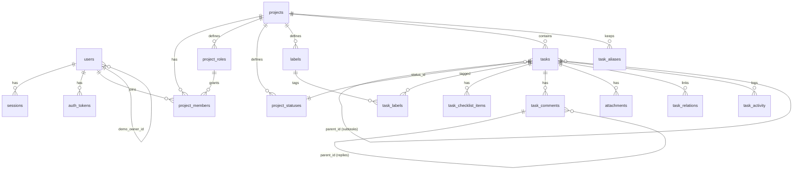

# Database

PostgreSQL 16 with the `citext` and `pg_trgm` extensions. The schema lives in plain SQL migrations under `server/src/db/migrations/NNN_name.sql`. Each milestone adds its own file.

## Migrations

- `pnpm db:migrate` applies pending files in name order, and the server also runs them on boot.
- The runner takes `pg_advisory_lock(727001)`, applies each file in its own transaction, and records it in `schema_migrations`.
- Applied migrations are never edited. A change always goes in a new file.

## Entity overview

## Tables

### `users` — migration 001

| Column              | Type                     | Notes                                                                                                                       |
| ------------------- | ------------------------ | --------------------------------------------------------------------------------------------------------------------------- |
| `id`                | uuid PK                  | `gen_random_uuid()`                                                                                                         |
| `email`             | citext, unique           | Always stored lowercase. Case-insensitive uniqueness comes from `citext`.                                                   |
| `password_hash`     | text, null               | argon2id. `NULL` for demo teammates, so they cannot log in with a password.                                                 |
| `name`              | text                     | 1–80 chars (CHECK).                                                                                                         |
| `avatar_key`        | text, null               | Storage key under `UPLOAD_DIR/avatars/`. The URL carries the first 8 chars as a cache-busting version.                      |
| `email_verified_at` | timestamptz, null        | Reset to `NULL` when the email changes.                                                                                     |
| `preferences`       | jsonb                    | Partial `{style, mode, nav, timezone}`. Defaults are merged in at read time. A PATCH merges with `preferences \|\| $patch`. |
| `demo_owner_id`     | uuid FK → users, cascade | Set on generated demo teammates. Deleting the real user deletes their demo teammates too. Partial index on non-null values. |

### `sessions` — migration 001

| Column             | Type             | Notes                                                                                 |
| ------------------ | ---------------- | ------------------------------------------------------------------------------------- |
| `token_hash`       | bytea, unique    | `sha256(cookie token)`. Every request looks the session up through this unique index. |
| `user_id`          | uuid FK, cascade |                                                                                       |
| `impersonator_id`  | uuid FK, null    | The real user while "View as" a demo teammate is active.                              |
| `expires_at`       | timestamptz      | Rolling 30 days, refreshed at most once a day.                                        |
| `user_agent`, `ip` | text, inet       | For auditing and future session management.                                           |

### `auth_tokens` — migration 001

| Column       | Type                                   | Notes                                                                                                                                                                                  |
| ------------ | -------------------------------------- | -------------------------------------------------------------------------------------------------------------------------------------------------------------------------------------- |
| `type`       | enum `verify_email` / `reset_password` |                                                                                                                                                                                        |
| `token_hash` | bytea, unique                          | `sha256(token)`. The raw token exists only in the email link.                                                                                                                          |
| `email`      | citext                                 | The address the token was issued for. Verification only succeeds while `users.email` still matches, so old links stop working after an email change.                                   |
| `expires_at` | timestamptz                            | 48h for verification, 1h for password reset.                                                                                                                                           |
| `used_at`    | timestamptz, null                      | Tokens are consumed with a single atomic `UPDATE … WHERE used_at IS NULL AND expires_at > now() RETURNING`. Issuing a new token voids the user's older unused tokens of the same type. |

### `projects` — migration 002

| Column                                 | Type                                         | Notes                                                                                  |
| -------------------------------------- | -------------------------------------------- | -------------------------------------------------------------------------------------- |
| `key`                                  | citext, unique, CHECK `^[A-Z][A-Z0-9]{1,5}$` | Globally unique and immutable. Used in URLs and task identifiers.                      |
| `name`, `description`, `color`, `icon` | text                                         | `icon` is a name from the client's curated lucide set.                                 |
| `owner_id`                             | uuid FK users                                | Must match the single member who holds the `owner` system role.                        |
| `task_seq`                             | int                                          | The last allocated task number (see Invariants).                                       |
| `archived_at`                          | timestamptz, null                            | Archived projects are read-only: every mutation except restore and delete returns 409. |
| `is_demo`                              | bool                                         | Marks generated demo data.                                                             |

### `project_roles` — migration 002

Each project has 4 system roles (`system_key` = owner/admin/member/viewer) plus any custom roles (`system_key` NULL). `permissions` is an int bitmask (`shared/src/permissions.ts`). Names are unique per project (case-insensitive index), and `UNIQUE (project_id, system_key)` allows one of each system role.

| Bit | Permission              | Admin | Member | Viewer |
| --- | ----------------------- | ----- | ------ | ------ |
| 0   | task.create             | ✓     | ✓      |        |
| 1   | task.edit_own           | ✓     | ✓      |        |
| 2   | task.edit_any           | ✓     | ✓      |        |
| 3   | task.transition         | ✓     | ✓      |        |
| 4   | task.assign_self        | ✓     | ✓      |        |
| 5   | task.assign_others      | ✓     | ✓      |        |
| 6   | task.delete             | ✓     |        |        |
| 7   | task.move               | ✓     |        |        |
| 8   | comment.create          | ✓     | ✓      |        |
| 9   | comment.moderate        | ✓     |        |        |
| 10  | attachment.upload       | ✓     | ✓      |        |
| 11  | attachment.delete_any   | ✓     |        |        |
| 12  | project.edit            | ✓     |        |        |
| 13  | project.manage_workflow | ✓     |        |        |
| 14  | project.manage_labels   | ✓     | ✓      |        |
| 15  | project.manage_members  | ✓     |        |        |
| 16  | project.manage_roles    | ✓     |        |        |
| 17  | project.archive         | ✓     |        |        |

The owner role holds every bit, can't be edited, and is the only role that can delete the project.

### `project_members` — migration 002

PK `(project_id, user_id)`. `role_id` uses `ON DELETE RESTRICT`, so deleting a role first moves its members to another role in the same transaction. `is_favorite` and `last_opened_at` are per user and drive sidebar ordering. Indexed on `user_id` (for "my projects") and on `role_id`.

### `project_statuses` and `labels` — migration 002

Statuses belong to a `workflow` (task/bug) and have a `category` (`backlog | todo | in_progress | done`). `position` is a fractional-index string with `COLLATE "C"`, so byte order equals sort order. Status names are unique per workflow and label names are unique per project, both case-insensitive.

### `tasks` and children — migration 003

`tasks` holds every work item: tasks, bugs, features, improvements and subtasks (`parent_id`). Bug-only fields are plain columns, so a task is read in one row with no joins. Denormalized counters avoid aggregate joins when rendering board cards. `search_vector` is a generated `tsvector` (title weighted A, description B) with a GIN index, and titles also have a trigram GIN index.

Child tables: `task_aliases` (old identifiers of moved tasks), `task_labels`, `task_checklist_items`, `task_comments` (one level of replies via `parent_id`), `attachments` (`task_id` NULL while a file is pending for a task not yet created), `task_relations` (canonical ordering, unique per type), and `task_activity` (bigserial; `task_id` is `SET NULL` on delete so project feeds keep a "deleted" entry).

## Invariants

- **Project keys** are globally unique (case-insensitive), match `^[A-Z][A-Z0-9]{1,5}$`, and never change after creation.
- **Task numbers** are unique per project and allocated with `UPDATE projects SET task_seq = task_seq + 1 … RETURNING task_seq` inside the insert transaction. The row lock on the project makes this race-free.
- **Moved tasks** get a new number in the target project. The old `(project_id, number)` is kept in `task_aliases`, so old links still resolve.
- **Ownership:** each project has exactly one member holding the `owner` system role, and that member equals `projects.owner_id`.
- **Workflows:** every project has two workflows, `task` and `bug`. Each must keep at least one status in the `backlog`/`todo` categories and at least one in `done`. Deleting a status requires a target status for its tasks.
- **Completion:** `tasks.completed_at` is set when a task enters a `done`-category status and cleared when it leaves one.
- **Counters:** `comment_count`, `attachment_count`, `checklist_total/done` and `subtask_total/done` on `tasks` are updated in the same transaction as the change they count. Tests compare them against fresh recounts.
- **Demo tagging:** demo rows carry `projects.is_demo = true`, and demo users have `users.demo_owner_id` set. Demo users have no password.

## Key query patterns

| Need           | Pattern                                                                                                                                                                               |
| -------------- | ------------------------------------------------------------------------------------------------------------------------------------------------------------------------------------- |
| Board ordering | Fractional string keys in `tasks.position` (`fractional-indexing`, `COLLATE "C"`). A drag updates one row and never reindexes.                                                        |
| Board load     | One query with `row_number() OVER (PARTITION BY status_id ORDER BY position)`, capped at 100 cards per column, plus per-column totals.                                                |
| Project stats  | One aggregate query per request, using `count(*) FILTER (WHERE category = 'done')` and similar for total, completed, active and overdue, joined to `project_statuses` for categories. |
| Overdue        | `due_date < (now() AT TIME ZONE $tz)::date AND category <> 'done'`, where `$tz` is the user's stored timezone.                                                                        |
| Search         | Exact `KEY-123` match first; otherwise `search_vector @@ to_tsquery('simple', 'a & b:*')` combined with trigram `similarity(title, q)`. Projects and tasks come back in one query.    |
| Activity       | A PATCH diffs the old and new rows and writes all changes with one multi-row `INSERT`.                                                                                                |
| Bulk edits     | `UPDATE … WHERE id = ANY($1)`, with activity written by `INSERT … SELECT`.                                                                                                            |

## Backups

- `scripts/backup.sh` runs `pg_dump -Fc` and tars `UPLOAD_DIR` into `BACKUP_DIR`, keeping the 14 newest copies.
- `scripts/restore.sh <dump> <uploads.tar.gz>` restores both.
- Render's managed Postgres also takes daily snapshots on paid plans.
