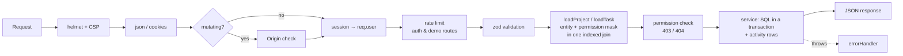

# Server Architecture

The API is a single Express 5 process (`server/`). It talks to PostgreSQL through `pg`, using raw parameterized SQL with no ORM. In production the same process serves the built client (`client/dist`), so the browser, the PWA and the API all share one origin.

## Layout

```
server/src
├── index.ts              # boot: migrate → listen
├── app.ts                # createApp(): middleware, /api router, static client
├── config.ts             # zod-validated env (.env loaded via process.loadEnvFile)
├── db/
│   ├── pool.ts           # Pool + query/queryOne/prepared/transaction helpers
│   ├── migrate.ts        # SQL migration runner (advisory lock, schema_migrations)
│   ├── migrateCli.ts
│   └── migrations/NNN_*.sql
├── lib/                  # httpError, logger, tokens, passwords, mailer, storage, upload, position
├── middleware/           # session, originCheck, rateLimits, errorHandler
└── modules/<domain>/     # routes.ts (HTTP) + service.ts (SQL) per domain
                          # auth, users, projects, statuses, labels, roles, members, tasks,
                          # comments, checklist, relations, attachments, insights, search, demo, dev
```

Inside a module, `routes.ts` only parses input with shared zod schemas, runs permission checks, and calls a service. `service.ts` holds the SQL. Its SQL strings are consts at the top of the file, followed by the functions. A service never touches `req` or `res`, so tests and the demo generator can reuse it.

## Request lifecycle



- **404 vs 403.** A non-member gets `404` for any project or task URL, so the API never reveals that the entity exists. A member who lacks a permission gets `403` with `details.missing`, which lists the missing permission keys.
- **Errors.** `HttpError` carries a status and message. A `ZodError` becomes a `400` with field paths. A Postgres unique violation becomes `409`. Anything else is logged and returned as a generic `500`.

## Auth & sessions

- **Passwords** are hashed with argon2id (`@node-rs/argon2`) and must be 8–128 characters.
- **Session tokens** are 32 random bytes in an httpOnly, `SameSite=Lax` cookie. The cookie is `__Host-sid` with `Secure` in production and `sid` in dev. The database stores only `sha256(token)`, so a database leak does not expose live sessions.
- **Expiry** is rolling: 30 days, with `expires_at` refreshed at most once a day so most requests don't write.
- **Revocation.** Login rotates the session. Logout deletes the row. A password change revokes the user's other sessions, and a password reset revokes all of them.
- **Email verification and password reset** use single-use, expiring tokens, also stored hashed in `auth_tokens`. Unverified users can still sign in and see a banner.
- **CSRF.** Mutating requests must carry an `Origin` header matching `APP_URL` (on top of `SameSite=Lax`).
- **Rate limits.** Login allows 10 attempts per 15 minutes per IP+email. Register, forgot and resend allow 5 per hour. Demo generation allows 10 per hour.
- **Account enumeration.** Login errors are generic, and forgot-password always returns 200.

## Permissions

Each project has roles in `project_roles`, and each role stores an **integer bitmask** (flags in `shared/src/permissions.ts`). `loadProject` and `loadTask` return the caller's mask in the same query that resolves the entity, so a check is a single bitwise AND.

- **System roles.** Every project gets `owner`, `admin`, `member` and `viewer`. Only the owner role is locked: it has every permission and is the only role that can delete the project.
- **Custom roles** can be created, cloned, renamed, or deleted. Deleting a role moves its members to a replacement role you choose.
- **Field-level task checks.** `missingTaskPermissions()` is shared by the client and the server:
  - `statusId` / `position` → `task.transition`
  - `assigneeId` → `task.assign_self`, or `task.assign_others` when anyone other than the caller is involved
  - any other field → `task.edit_own` (reporter or assignee) or `task.edit_any`
- **No escalation.** An actor can only grant a role, or edit a role's permissions, if the result is a subset of their own permissions (`mask & ~actorMask = 0`).

## Tasks

**Identifiers.** A task's identifier is `KEY-number`. The number comes from `UPDATE projects SET task_seq = task_seq + 1 … RETURNING`, inside the same transaction as the insert, so concurrent creates never collide. `GET /tasks/by-identifier/:identifier` resolves current numbers first, then `task_aliases`, so links to moved tasks keep working.

**Workflows and categories.** Each project has a `task` workflow and a `bug` workflow, each with its own statuses. Every status has a category (`backlog`, `todo`, `in_progress`, `done`), and the server only reasons in categories:

- Entering a `done` status sets `completed_at`; leaving one clears it. Progress, "active" and "overdue" all derive from this.
- Changing a task's type to or from `bug` moves it to the other workflow. The new status is the first one whose category matches, falling back in the order of `CATEGORY_FALLBACK` (for example `in_progress → todo → backlog → done`).
- Bulk status changes on a mixed selection send a category, and each task resolves it within its own workflow.
- `POST /tasks/:id/reopen` moves a done task to the first `todo` status of its workflow (falling back to `backlog`).

**Edits.** `PATCH /tasks/:id` checks permissions per field (see Permissions), diffs the old and new row, and writes all changes plus one multi-row activity insert in a single transaction. Clients update optimistically and roll back on error.

**Move and duplicate.** Moving a task to another project gives it the next number there, records the old identifier in `task_aliases`, and remaps status, labels and assignee:

- **Status** goes to a status of the same category in the target project.
- **Labels** are kept only when a label with the same name exists in the target project.
- **Assignee** is kept only if they are a member there.

Subtasks move with their parent, and so does the task's activity history. Duplicating copies the fields and labels, adds "(copy)" to the title, and copies the checklist with every item unchecked. It does not copy comments or attachments.

**Counters.** Board cards render from denormalized counters on `tasks`, so the board query never joins comments, files or checklists. Each counter changes in the same transaction as the row it counts. Subtask counters on parents are recomputed with one `UPDATE … FROM (aggregate)` for every affected parent (`REFRESH_PARENTS`), which also covers moves, deletes and status changes.

**Board.** `GET /projects/:key/board?workflow=` returns every column in one query: `row_number() OVER (PARTITION BY status_id ORDER BY position)` caps each column at 100 cards and reports the true total, and "Show more" fetches the next page of one column. Positions are fractional-index strings (`COLLATE "C"`), so a drag updates one row.

**Filters.** List, Bugs, Board and My Tasks share `buildTaskFilter()`, which builds parameterized SQL for:

- status, category, type, priority, severity, assignee (`me` and `none` included) and label
- due and created date ranges, overdue, blocked, hide-completed and top-level only
- `q`, matched as an exact identifier, a prefix full-text match, or an escaped `ILIKE`

Sorting maps a whitelisted key to SQL (`sortSql`), always with `t.number DESC` as the tiebreaker.

## Collaboration

- **Comments** support one level of replies. Authors can edit and delete their own; `comment.moderate` lets others delete them. Attachments pasted into a comment are linked to it.
- **Checklist items** use fractional positions, like board cards.
- **Relations** are `relates` (symmetric, stored in canonical id order so A→B and B→A are the same row) or `duplicates` (directional). Each pair is unique per type. `blocks` exists in the enum for Phase 2.
- **Attachments:** see Uploads & storage. Image pastes in any rich-text field upload first and insert a link to the stored file into the markdown.

## Insights & search

- **Dashboard** (`GET /dashboard`) runs three queries in parallel. A CTE scopes them to the caller's projects, then computes totals, 14-day created and completed trends (`generate_series` joined to daily counts), per-project stats, high-priority bugs, upcoming deadlines and recent activity.
- **My Tasks** (`GET /me/tasks`) returns open and recently completed tasks assigned to the caller across projects. The client groups them by deadline, project, priority or status.
- **Project overview and activity:** the overview returns stats, status and priority breakdowns and trends. The activity feed is keyset-paginated (`?before=<id>&limit=`) on `task_activity (project_id, created_at DESC)`.
- **Search** (`GET /search?q=`) runs a project query and a task query in parallel, both limited to the caller's memberships. Tasks match an exact identifier first, then a prefix `tsquery`, an escaped `ILIKE`, or trigram `<%` (word similarity at least 0.5, set on the pool connection, so `pricng` still finds "Pricing"). Results are ranked by exact match, then `ts_rank`, then recency.

## Uploads & storage

- **Limits.** `multer` writes uploads to a temp location, capped at `MAX_UPLOAD_MB` per file and 10 files per request.
- **Type check.** The real type comes from the file's magic bytes (`file-type`). The allowlist is: png, jpeg, gif, webp, mp4, webm, mov, pdf, zip, and text formats. SVG and HTML are always rejected.
- **Storage.** Files are stored under `UPLOAD_DIR` with random keys outside the web root, and served only through an authorized route with `X-Content-Type-Options: nosniff`. Non-images are sent as downloads.
- **Deletion.** When a task or project is deleted, its files are removed after the transaction commits.
- **Pending uploads.** Uploads made before a task exists (`task_id IS NULL`) are linked when the task is created. Pending uploads older than 24h are purged every hour.

## Mail

Mail goes out through the first configured transport:

1. **Resend** (`RESEND_API_KEY`): an HTTPS `POST` to `api.resend.com/emails`. This is the production choice, because Render's free plan blocks outbound SMTP ports. `MAIL_FROM` must use the domain verified in Resend.
2. **SMTP** (`SMTP_URL`) through `nodemailer`.
3. Neither (dev and test only): an in-memory **dev mailbox** exposed at `GET /api/dev/mailbox?to=`, which the e2e tests use. In production without a transport, links are written to the log.

A failed send never undoes the action that triggered it: registration and email changes log the error and the user can resend from the banner. `POST /auth/resend-verification` itself answers `502` so the user sees that it failed. Verification links can be opened more than once, so a mail scanner that opens the link first doesn't leave the user with an "invalid link" error.

## Demo data

`modules/demo` builds a realistic dataset from a seeded PRNG, so the same seed always produces the same data. Each table gets one bulk `INSERT … SELECT FROM unnest(…)`, counters are filled by a single aggregate `UPDATE`, and everything runs in one transaction.

Demo rows are tagged with `projects.is_demo` and `users.demo_owner_id`. **Remove** deletes only the caller's demo set. **View as** creates a session for one of the caller's own demo teammates; the session records `impersonator_id` so the user can switch back. The whole module is off when `ENABLE_DEMO_DATA=false`.

| Size  | Contents                                                                                                 | Time   |
| ----- | -------------------------------------------------------------------------------------------------------- | ------ |
| Small | 3 projects (one owned by a demo teammate and shared with you) plus an archived legacy project, ~80 tasks | ~0.3 s |
| Large | 8 projects × 250 tasks, one archived                                                                     | ~1.1 s |

Every project gets a custom **QA** role, labels, subtasks, checklists, threaded comments, relations, bundled sample attachments (copied from `modules/demo/assets` into storage) and activity backdated across 60 days.

Routes (all under `requireAuth`, rate limited): `GET /demo`, `POST /demo {size, seed?}` (replaces the current set), `DELETE /demo`, `POST /demo/impersonate/:userId` and `POST /demo/impersonate/stop`. Managing demo data is blocked while impersonating. `GET /config` reports whether the module is on, so the client hides the Settings tab when it is off.

`pnpm db:seed` (`seedCli.ts`) creates `demo@msr.local` / `demo-password` and generates a Small set with seed 42.

## API reference

All routes are under `/api`, take and return JSON, and validate input with the shared zod schemas. Every route after `/auth` requires a session.

| Area                | Routes                                                                                                                                                                                           |
| ------------------- | ------------------------------------------------------------------------------------------------------------------------------------------------------------------------------------------------ |
| Health & config     | `GET /health`, `GET /config`                                                                                                                                                                     |
| Auth                | `POST /auth/register`, `/auth/login`, `/auth/logout`, `/auth/verify-email`, `/auth/resend-verification`, `/auth/forgot-password`, `/auth/reset-password`; `GET /auth/me`                         |
| Me                  | `PATCH /me` (name, preferences), `PUT /me/password`, `PUT /me/email`, `DELETE /me/avatar` (uploads are off for now), `GET /users/:id/avatar`, `GET /me/tasks`                                    |
| Projects            | `GET`/`POST /projects`, `GET /projects/key-available`, `GET`/`PATCH`/`DELETE /projects/:key`, `POST /projects/:key/archive`, `/restore`, `PUT /projects/:key/favorite`                           |
| Workflow & labels   | `POST /projects/:key/statuses`, `PATCH`/`DELETE …/statuses/:id` (delete takes a target status); same shape for `…/labels`                                                                        |
| Roles & members     | `GET`/`POST /projects/:key/roles`, `PATCH`/`DELETE …/roles/:id` (delete takes a replacement role); `GET`/`POST /projects/:key/members`, `PATCH`/`DELETE …/members/:userId`                       |
| Project tasks       | `GET`/`POST /projects/:key/tasks`, `PATCH …/tasks/bulk`, `POST …/tasks/bulk-delete`, `GET …/board`, `GET …/overview`, `GET …/activity`                                                           |
| Tasks               | `GET /tasks/by-identifier/:identifier`; `GET`/`PATCH`/`DELETE /tasks/:id`; `POST /tasks/:id/duplicate`, `/reopen`, `/move`; `GET /tasks/:id/activity`, `/subtasks`                               |
| Collaboration       | `GET`/`POST /tasks/:id/comments`, `PATCH`/`DELETE /comments/:id`; `GET`/`POST /tasks/:id/checklist`, `PATCH`/`DELETE /checklist/:id`; `GET`/`POST /tasks/:id/relations`, `DELETE /relations/:id` |
| Files               | `POST /attachments` (pending), `GET`/`POST /tasks/:id/attachments`, `GET`/`DELETE /attachments/:id`                                                                                              |
| Insights & search   | `GET /dashboard`, `GET /search?q=`                                                                                                                                                               |
| Demo (when enabled) | `GET`/`POST`/`DELETE /demo`, `POST /demo/impersonate/:userId`, `POST /demo/impersonate/stop`                                                                                                     |
| Dev only            | `GET /dev/mailbox?to=` (no SMTP and not production)                                                                                                                                              |

## Security summary

| Threat                           | Mitigation                                                                                                                                                                                                                    |
| -------------------------------- | ----------------------------------------------------------------------------------------------------------------------------------------------------------------------------------------------------------------------------- |
| Credential theft                 | argon2id passwords. Hashed session and email tokens. httpOnly `__Host-` cookie. Rolling expiry. Revocation on password change or reset                                                                                        |
| CSRF                             | `SameSite=Lax`, plus an `Origin` check on every mutating request                                                                                                                                                              |
| Account enumeration and guessing | Generic login errors. Forgot-password always returns 200. A dummy argon2 hash keeps login timing the same for unknown and demo users. Rate limits                                                                             |
| Broken access control            | One loader per entity returns the caller's permission mask. Non-members get 404. Per-field task checks. Escalation guard on roles. Table-driven tests for both 404s and permissions                                           |
| Injection                        | Parameterized SQL only. Sort keys are whitelisted. `LIKE` input is escaped                                                                                                                                                    |
| XSS                              | Content is markdown rendered by Tiptap's schema, so scripts, raw HTML, event handlers and `javascript:` links are dropped. Image sources are limited to relative, http(s), blob and raster data URLs. CSP `script-src 'self'` |
| Malicious uploads                | Type checked by magic bytes against an allowlist (no SVG or HTML). Files get random keys, are served with `nosniff`, and non-images download as attachments. Size and count limits                                            |
| Open redirect                    | The client only follows same-origin `?next=` paths                                                                                                                                                                            |
| Denial of service                | Body, upload and query-length limits. Pagination caps. Rate limits on auth and demo routes. zod kept at 4.6.7 or later (memory advisory GHSA-mrhx-c7xc-m3w5)                                                                  |
| Stale or poisoned caches         | The service worker never caches `/api`. Only hashed `/assets` are cached long-term, and `sw.js` is `no-cache`                                                                                                                 |

## Config

| Variable                                  | Purpose                                                                                                                                               |
| ----------------------------------------- | ----------------------------------------------------------------------------------------------------------------------------------------------------- |
| `DATABASE_URL` / `TEST_DATABASE_URL`      | Postgres connections (tests use the second)                                                                                                           |
| `APP_URL`                                 | Public origin for email links and the Origin check. Falls back to Render's `RENDER_EXTERNAL_URL`, then `http://localhost:5173`                        |
| `PORT`                                    | HTTP port (default 4000)                                                                                                                              |
| `UPLOAD_DIR`, `MAX_UPLOAD_MB`             | Attachment storage and size limit                                                                                                                     |
| `RESEND_API_KEY`, `SMTP_URL`, `MAIL_FROM` | Outgoing mail (Resend first, then SMTP). Without either, mail is logged (and kept in the dev mailbox outside production). Blank values count as unset |
| `ENABLE_DEMO_DATA`                        | Turns the demo-data module on or off (default on)                                                                                                     |
| `CLIENT_DIST`                             | When set, Express serves the built SPA from this path                                                                                                 |

## Testing

| Suite  | Command                       | What it covers                                                                                                                                                                                                                                                                                                                                                                                                                                                            |
| ------ | ----------------------------- | ------------------------------------------------------------------------------------------------------------------------------------------------------------------------------------------------------------------------------------------------------------------------------------------------------------------------------------------------------------------------------------------------------------------------------------------------------------------------- |
| Server | `pnpm --filter ./server test` | Vitest and supertest against the real `msr_test` database. Migrations run once in `globalSetup`, and tables are truncated between files. Table-driven 404 tests for non-members on every project and task route. A permission-matrix test for every flag. Escalation and owner invariants, counters against recounts, workflows and remapping, move and aliases, uploads (spoofed types, SVG, size), demo determinism and isolation, static caching, and config fallbacks |
| Shared | `pnpm --filter ./shared test` | Permission logic, identifiers and branch slugs                                                                                                                                                                                                                                                                                                                                                                                                                            |
| Client | `pnpm --filter ./client test` | jsdom tests for the theme provider, the offline `ErrorState`, the API client's network errors, `safeNextPath`, and rich-text sanitization                                                                                                                                                                                                                                                                                                                                 |
| E2E    | `pnpm e2e`                    | Playwright on Chromium. It recreates `msr_e2e`, builds the app and serves it on port 4300. There is one spec per MVP criterion (`e2e/01`–`10`), plus demo data, an iPhone/PWA project (installability, offline shell, no horizontal overflow at 390 px), and an axe WCAG 2 A/AA scan in all four themes                                                                                                                                                                   |

The e2e specs locate elements by role and accessible name rather than test ids. A control that can't be found that way is usually an accessibility bug, and several were fixed that way. The suite runs fully parallel and has been checked repeatedly under CPU load for flakiness.

## Deployment

**Image.** The multi-stage `Dockerfile` installs with the frozen lockfile, builds `client` and `server` (tsup bundles `shared` in), and copies only production dependencies (`pnpm deploy --prod`) into a `node:22-slim` runtime. The server bundle lives at `/app/dist`, with migrations and demo assets beside it, and the built client at `/app/client` (`CLIENT_DIST`).

**Entrypoint.** `scripts/docker-entrypoint.sh` starts as root only long enough to create `UPLOAD_DIR` and hand it to the `node` user. That is needed because Render mounts disks root-owned. It then `setpriv`s to `node` before running the app. The container has a `HEALTHCHECK` on `/api/health`.

**Boot.** The server runs migrations under a Postgres advisory lock, so several instances can start at once safely. `trust proxy` is enabled so rate limits and `Secure` cookies work behind Render's proxy.

**Render.** `render.yaml` defines the web service (Starter, required for the disk), a 1 GB disk at `/var/data/uploads`, and a managed Postgres 16 database wired in via `fromDatabase`.

### Static files and the PWA

| Path                                                         | Cache-Control                         |
| ------------------------------------------------------------ | ------------------------------------- |
| `/assets/*` (content-hashed)                                 | `public, max-age=31536000, immutable` |
| `/assets/*` that no longer exists                            | 404, never the SPA shell              |
| Other root files (`sw.js`, manifest, icons, `theme-boot.js`) | `no-cache`                            |
| Any other non-API path                                       | `index.html`, `no-cache`              |

`vite-plugin-pwa` generates the manifest and a Workbox service worker:

- **Icons.** Icons, the apple-touch icon and light/dark iOS splash screens are generated at build time from `client/public/logo.svg` (`pwa-assets.config.ts`).
- **Precache.** The service worker precaches the app shell. Splash images are left out because iOS reads them only while installing.
- **Navigation.** Navigations fall back to `index.html`, except `/api/*`. API responses are never cached, so nothing private stays on a shared phone after logout.
- **Updates.** Registration is `prompt`: the client checks for a new worker hourly and whenever the app returns to the foreground, then shows a **Reload** toast.
- **Offline.** The client turns a failed `fetch` into `ApiError(0)`. `ErrorState` shows an offline screen that retries on the `online` event, and the app shell shows an offline banner.
