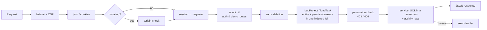

# Server Architecture

The API is a single Express 5 process (`server/`). It talks to PostgreSQL through `pg`, using raw parameterized SQL with no ORM. In production the same process serves the built client (`client/dist`), so the browser, the PWA and the API all share one origin.

## Layout

```
server/src
├── index.ts              # boot: migrate → listen
├── app.ts                # createApp(): middleware, /api router, static client
├── config.ts             # zod-validated env (.env loaded via process.loadEnvFile)
├── db/
│   ├── pool.ts           # Pool + query/queryOne/prepared/transaction helpers
│   ├── migrate.ts        # SQL migration runner (advisory lock, schema_migrations)
│   ├── migrateCli.ts
│   └── migrations/NNN_*.sql
├── lib/                  # httpError, logger, tokens, mailer, storage, …
├── middleware/           # auth, origin check, rate limits, validate, loaders, errorHandler
└── modules/<domain>/     # routes.ts (HTTP) + service.ts (SQL) per domain
```

Inside a module, `routes.ts` only parses input with shared zod schemas, runs permission checks, and calls a service. `service.ts` holds the SQL. Its SQL strings are consts at the top of the file, followed by the functions. A service never touches `req` or `res`, so tests and the demo generator can reuse it.

## Request lifecycle



- **404 vs 403.** A non-member gets `404` for any project or task URL, so the API never reveals that the entity exists. A member who lacks a permission gets `403` with `details.missing`, which lists the missing permission keys.
- **Errors.** `HttpError` carries a status and message. A `ZodError` becomes a `400` with field paths. A Postgres unique violation becomes `409`. Anything else is logged and returned as a generic `500`.

## Auth & sessions

- **Passwords** are hashed with argon2id (`@node-rs/argon2`) and must be 8–128 characters.
- **Session tokens** are 32 random bytes in an httpOnly, `SameSite=Lax` cookie. The cookie is `__Host-sid` with `Secure` in production and `sid` in dev. The database stores only `sha256(token)`, so a database leak does not expose live sessions.
- **Expiry** is rolling: 30 days, with `expires_at` refreshed at most once a day so most requests don't write.
- **Revocation.** Login rotates the session. Logout deletes the row. A password change revokes the user's other sessions, and a password reset revokes all of them.
- **Email verification and password reset** use single-use, expiring tokens, also stored hashed in `auth_tokens`. Unverified users can still sign in and see a banner.
- **CSRF.** Mutating requests must carry an `Origin` header matching `APP_URL` (on top of `SameSite=Lax`).
- **Rate limits.** Login allows 10 attempts per 15 minutes per IP+email. Register, forgot and resend allow 5 per hour. Demo generation allows 10 per hour.
- **Account enumeration.** Login errors are generic, and forgot-password always returns 200.

## Permissions

Each project has roles in `project_roles`, and each role stores an **integer bitmask** (flags in `shared/src/permissions.ts`). `loadProject` and `loadTask` return the caller's mask in the same query that resolves the entity, so a check is a single bitwise AND.

- **System roles.** Every project gets `owner`, `admin`, `member` and `viewer`. Only the owner role is locked: it has every permission and is the only role that can delete the project.
- **Custom roles** can be created, cloned, renamed, or deleted. Deleting a role moves its members to a replacement role you choose.
- **Field-level task checks.** `missingTaskPermissions()` is shared by the client and the server:
  - `statusId` / `position` → `task.transition`
  - `assigneeId` → `task.assign_self`, or `task.assign_others` when anyone other than the caller is involved
  - any other field → `task.edit_own` (reporter or assignee) or `task.edit_any`
- **No escalation.** An actor can only grant a role, or edit a role's permissions, if the result is a subset of their own permissions (`mask & ~actorMask = 0`).

## Uploads & storage

- **Limits.** `multer` writes uploads to a temp location, capped at `MAX_UPLOAD_MB` per file and 10 files per request.
- **Type check.** The real type comes from the file's magic bytes (`file-type`). The allowlist is: png, jpeg, gif, webp, mp4, webm, mov, pdf, zip, and text formats. SVG and HTML are always rejected.
- **Storage.** Files are stored under `UPLOAD_DIR` with random keys outside the web root, and served only through an authorized route with `X-Content-Type-Options: nosniff`. Non-images are sent as downloads.
- **Deletion.** When a task or project is deleted, its files are removed after the transaction commits.
- **Pending uploads.** Uploads made before a task exists (`task_id IS NULL`) are linked when the task is created. Pending uploads older than 24h are purged every hour.

## Mail

When `SMTP_URL` is set, `nodemailer` sends mail through it. Without it (dev and test only), mail goes to an in-memory **dev mailbox** exposed at `GET /api/dev/mailbox?to=`, which the e2e tests use. In production without SMTP, links are written to the log.

## Demo data

`modules/demo` builds a realistic dataset from a seeded PRNG, so the same seed always produces the same data. Each table gets one bulk `INSERT … SELECT FROM unnest(…)`, counters are filled by a single aggregate `UPDATE`, and everything runs in one transaction.

Demo rows are tagged with `projects.is_demo` and `users.demo_owner_id`. **Remove** deletes only the caller's demo set. **View as** creates a session for one of the caller's own demo teammates; the session records `impersonator_id` so the user can switch back. The whole module is off when `ENABLE_DEMO_DATA=false`.

## Config

| Variable | Purpose |
|---|---|
| `DATABASE_URL` / `TEST_DATABASE_URL` | Postgres connections (tests use the second) |
| `APP_URL` | Public origin; used for email links and the Origin check |
| `PORT` | HTTP port (default 4000) |
| `UPLOAD_DIR`, `MAX_UPLOAD_MB` | Attachment storage and size limit |
| `SMTP_URL`, `MAIL_FROM` | Outgoing mail |
| `ENABLE_DEMO_DATA` | Turns the demo-data module on or off (default on) |
| `CLIENT_DIST` | When set, Express serves the built SPA from this path |

## Testing

- **Server:** Vitest + supertest against a real Postgres test database. Migrations run once in `globalSetup`, and tables are truncated between test files. The authorization tests are table-driven:
  - every project and task route returns 404 for non-members
  - every permission flag is checked against a role that has it and a role that doesn't
- **Shared logic** (permissions, identifiers) has pure unit tests.
- **E2E:** Playwright runs on Chromium, with one test per MVP completion criterion.

## Deployment

A multi-stage `Dockerfile` builds `shared`, `client` and `server`, then runs `node dist/index.js` as a non-root user. On boot the server runs migrations under a Postgres advisory lock, so it is safe if several instances start at once. `render.yaml` defines the web service, a managed Postgres database, and a persistent disk for `UPLOAD_DIR`. `trust proxy` is enabled so rate limits and `Secure` cookies work behind Render's proxy.

The client is a PWA: a manifest plus a Workbox service worker that precaches the app shell. `/api` responses are never cached.
